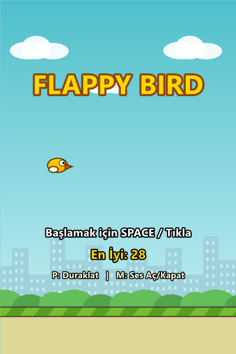
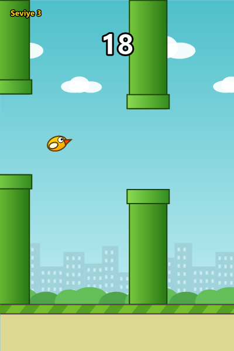
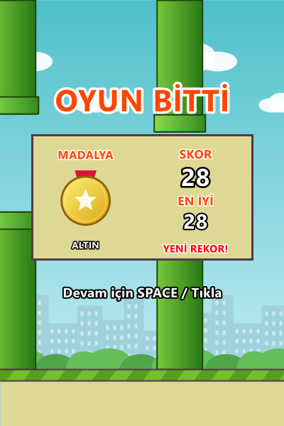

# Flappy Bird — C# / .NET 10 Windows Forms

**Nesne Tabanlı Programlama (Object-Oriented Programming)** dersi **1. Uygulama Ödevi** kapsamında C# ve .NET 10 Windows Forms kullanılarak geliştirilmiş, nesne yönelimli mimariye sahip **Flappy Bird** masaüstü oyunudur.

Harici hiçbir görsel veya ses dosyasına bağımlı olmadan; tüm grafikler (`GDI+`), parallax arka plan katmanları, kuş kanat animasyonu, madalya çizimleri ve ses efektleri (`RIFF/WAVE PCM`) tamamen kod ile prosedürel olarak üretilmektedir.

---

## Özellikler

- **Nesne Tabanlı Mimari (OOP):** Soyut temel sınıflar (`GameObject`, `ParallaxLayer`), arayüz tabanlı servis soyutlamaları (`IHighScoreRepository`, `ISoundService`), kapsülleme ve polimorfizm prensiplerine uygun modüler yapı.
- **Akıcı Oyun Döngüsü & Fizik:** `Stopwatch` tabanlı gerçek `deltaTime` hesaplaması ve `DoubleBuffered` (çift tamponlu) çizim ile titremesiz 60+ FPS hareket, yerçekimi ivmesi, zıplama fiziği ve hıza bağlı kuş rotasyonu.
- **Kuş Kanat Animasyonu:** Uçuş hızına göre kare hızı değişen 4 aşamalı kanat çırpma animasyonu ve menü ekranında sinüs dalgasıyla süzülme (`Hover`) hareketi.
- **Parallax Arka Plan:** Farklı hız çarpanlarıyla (`SpeedFactor`) kayan bulut (`CloudLayer`), şehir silüeti (`CityLayer`), çalı (`BushLayer`) ve şeritli zemin (`Ground`) katmanları.
- **Dinamik Zorluk Ölçekleme (`DifficultyScaler`):** Skor arttıkça boruların kayma hızı kademeli olarak artar, borular arası dikey geçiş boşluğu daralır ve sol üstte mevcut zorluk seviyesi (`Seviye 1-5`) gösterilir.
- **Madalya Sistemi (`MedalCalculator`):** Oyun sonunda kazanılan skora göre **Bronz (5+)**, **Gümüş (15+)**, **Altın (25+)** ve **Platin (40+)** madalya ödüllendirmesi.
- **Kalıcı En Yüksek Skor (`FileHighScoreRepository`):** En yüksek skor yerel dosya sisteminde (`LocalAppData\FlappyBirdCSharp\highscore.dat`) saklanır ve yeni rekor kırıldığında oyun sonu panelinde belirtilir.
- **Prosedürel Ses Efektleri (`WaveGenerator` & `SoundManager`):** Zıplama, puan kazanma, çarpma ve madalya kazanma sesleri çalışma zamanında bellekte 44.1 kHz 16-bit PCM olarak üretilir ve 4 kanallı polifonik `winmm.dll (waveOut)` motoruyla sıfır gecikmeli çalınır.
- **Durum Yönetimi (`GameState`):** Başlangıç Menüsü (`Menu`), Oyun İçi (`Playing`), Duraklatıldı (`Paused`) ve Oyun Bitti (`GameOver`) ekranları.

---

## Kullanılan Teknolojiler

| BileÅŸen | Teknoloji |
|---|---|
| **Programlama Dili** | C# 13 |
| **Çatı (Framework)** | .NET 10.0 (`net10.0-windows`) |
| **Arayüz & Grafik** | Windows Forms (WinForms) & `System.Drawing` (GDI+ Anti-Aliased Vector Rendering) |
| **Ses Motoru** | `winmm.dll (waveOut)` 4 kanallı polifonik ses motoru + Prosedürel 44.1 kHz PCM sentezleyici (`WaveGenerator`) |
| **Veri Kalıcılığı** | `System.IO` dosya tabanlı skor saklama (`IHighScoreRepository`) |

---

## Ekran Görüntüleri

| Başlangıç Menüsü | Oyun İçi (Seviye & Parallax) | Oyun Bitti & Madalya Paneli |
|:---:|:---:|:---:|
|  |  |  |

---

## Nesne Tabanlı Mimari ve Proje Yapısı

```text
FlappyBird/
├── FlappyBird.sln
├── README.md
├── .gitignore
├── screenshots/
│   ├── menu.png
│   ├── gameplay.png
│   └── gameover.png
└── FlappyBird/
    ├── FlappyBird.csproj
    ├── Program.cs                        # Uygulama giriş noktası
    ├── GameForm.cs                       # Ana pencere, oyun döngüsü ve durum makinesi
    ├── Core/
    │   ├── GameObject.cs                 # Tüm oyun nesneleri için soyut temel sınıf
    │   ├── GameState.cs                  # Oyun durumları (Menu, Playing, Paused, GameOver)
    │   ├── DifficultyScaler.cs           # Skora bağlı hız ve boru boşluğu ölçekleyici
    │   └── MedalCalculator.cs            # Madalya hesaplama ve vektörel madalya çizimi
    ├── Entities/
    │   ├── Bird.cs                       # Kuş fiziği, rotasyon ve kanat çırpma animasyonu
    │   ├── Pipe.cs                       # Üst/alt boru çifti ve çarpışma kontrolü
    │   ├── PipeManager.cs                # Boru üretimi, kaydırma ve skor sayımı
    │   └── Ground.cs                     # Kayan çimen şeritli zemin nesnesi
    ├── Rendering/
    │   ├── ParallaxLayer.cs              # Soyut parallax arka plan katmanı (Template Method)
    │   ├── BackgroundLayers.cs           # CloudLayer, CityLayer ve BushLayer sınıfları
    │   ├── Background.cs                 # Tüm arka plan katmanlarını yöneten bileşik sınıf
    │   └── OutlinedText.cs               # GraphicsPath tabanlı kenarlıklı metin çizici
    ├── Services/
    │   ├── IHighScoreRepository.cs       # Yüksek skor saklama arayüzü
    │   ├── FileHighScoreRepository.cs    # Dosya tabanlı yüksek skor kaydı
    │   └── ISoundService.cs              # Ses servisi arayüzü ve SoundEffect enum'u
    └── Audio/
        ├── WaveGenerator.cs              # Prosedürel 44.1 kHz 16-bit PCM ses dalgası üretici
        └── SoundManager.cs               # 4 kanallı polifonik waveOut ses yöneticisi
```

---

## Kurulum ve Çalıştırma Adımları

### Gereksinimler
- **.NET 10 SDK** (veya üzeri)
- Windows iÅŸletim sistemi

### 1. Projeyi Klonlayın
```bash
git clone https://github.com/Seha83/FlappyBird.git
cd FlappyBird
```

### 2. Projeyi Derleyin
```bash
dotnet build FlappyBird.sln
```

### 3. Uygulamayı Çalıştırın
```bash
dotnet run --project FlappyBird/FlappyBird.csproj
```

---

## Kontroller

| TuÅŸ / Girdi | Ä°ÅŸlev |
|---|---|
| `SPACE` / `W` / `Yukarı Ok` / `Sol Tık` | Oyunu başlat / Kuşu zıplat / Oyun sonunda menüye dön |
| `P` | Oyunu duraklat / devam ettir |
| `M` | Ses efektlerini aç / kapat (Sessiz mod) |
| `ESC` | Oyundan çık |
